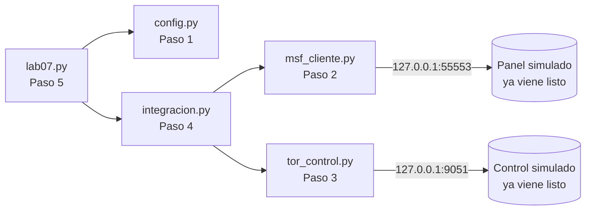

<!-- Idioma del documento: es-CO (español de Colombia) -->
# Guía paso a paso: controle Metasploit y una red de anonimato desde Python

En esta carpeta usted **arma la herramienta pieza por pieza**. En cada paso crea un archivo, pega el código que le da la guía, lo ejecuta y comprueba lo que aparece en pantalla. El código viene **comentado línea a línea para quien ve Python y este tema por primera vez**: cada elemento del lenguaje se explica la primera vez que aparece. Leer esos comentarios es la parte más importante del laboratorio.

Antes de ejecutar cada paso, la guía le pide una cosa sencilla: **adivine qué va a ver**. Luego ejecuta y compara. Esa pequeña predicción es la que hace que el tema se le quede.

Siglas y palabras que va a encontrar: RPC (Remote Procedure Call, llamada a procedimiento remoto: pedir por la red que otro programa ejecute una función), IP (Internet Protocol, la dirección de un equipo en la red), TCP (Transmission Control Protocol, protocolo de control de transmisión), panel de control (la parte de Metasploit que recibe órdenes), puerto de control (el canal de texto por el que se gobierna un servicio de anonimato) y NEWNYM (new identity, identidad nueva: la orden de armar un camino nuevo).

## Antes de empezar

### Qué ya viene en esta carpeta y qué crea usted

| Ya viene listo (no lo modifique) | Para qué sirve |
|---|---|
| `simulador_msfrpcd.py` | Hace de "panel de Metasploit" en `127.0.0.1` y deja abiertos tres puertos del objetivo. No necesita instalar Metasploit. |
| `simulador_tor.py` | Hace de "puerto de control" de una red de anonimato en `127.0.0.1`. No necesita instalar nada de esa red. |
| `pasos/` | Un script de comprobación por paso. |
| `validar.py` | Comprobación final (lo que puede fallar). |
| `test_red_permitida.py`, `test_integracion.py`, `test_simuladores.py` | 10 pruebas automáticas que revisan su código. |
| `ejecutar_laboratorio.sh`, `limpiar.sh` | Comprobación final completa y limpieza. |

| Lo crea usted (pegando el código de la guía) | Paso |
|---|---|
| `config.py` | 1 |
| `msf_cliente.py` | 2 |
| `tor_control.py` | 3 |
| `integracion.py` | 4 |
| `lab07.py` | 5 |

### Cómo trabajar cada paso

1. **Lea la idea** del paso: qué va a armar y para qué.
2. **Cree el archivo** con su editor, dentro de esta carpeta. Por ejemplo, `code config.py` o `nano config.py`.
3. **Copie el bloque de código completo** y péguelo. En GitHub, cada bloque tiene un botón de copiar en la esquina superior derecha.
4. **Guarde** el archivo.
5. **Prediga**: lea la pregunta "Antes de ejecutar" y escriba en una hoja qué cree que va a pasar.
6. **Ejecute la comprobación** del paso y compare lo que ve con su predicción y con la salida esperada.
7. **Lea los comentarios del código** (las líneas con `#` y los textos entre `"""`). Explican cada parte.

Si algo no funciona, lo más común es que el código se haya pegado incompleto o con la sangría cambiada. Compare su archivo con la respuesta: `diff config.py ../solucion/config.py` (si no muestra nada, son idénticos).

### Cómo se conecta todo



No hay máquinas virtuales ni Metasploitable: los dos simuladores escuchan solo en `127.0.0.1`, de modo que ningún paquete sale de su equipo. Nada de tráfico real por la red de anonimato: solo se envían órdenes de control.

### Requisitos

- Linux, macOS o Windows con WSL (Windows Subsystem for Linux, subsistema de Linux para Windows).
- Python 3.10 o superior, con `venv` y `pip`.
- Un editor de código (VS Code, nano o vim).
- Conocimientos previos: **no necesita saber Python**; los comentarios del código le explican lo necesario.

Trabaje con **tres terminales abiertas en esta carpeta (`paso-a-paso/`)**: la terminal A para el panel simulado, la terminal B para el control simulado y la terminal C para todo lo demás. Active el entorno virtual (Paso 0) en las tres.

### Python mínimo para este laboratorio

Si nunca ha usado Python, lea esto una vez; el resto lo explican los comentarios del código.

- **Un programa de Python es un archivo de texto** que termina en `.py`. Se escribe (o se pega) en un editor y se guarda.
- **Se ejecuta desde la terminal** con `python3 nombre_del_archivo.py`. Python lee el archivo de arriba hacia abajo.
- **Los comentarios** empiezan con `#` y los textos entre `"""` describen archivos y funciones. Python no los ejecuta: son explicaciones para usted.
- **La sangría (los espacios al inicio de la línea) es obligatoria.** Debe quedar exactamente igual al pegar: 4 espacios por nivel, nunca tabulaciones.
- **Mayúsculas y minúsculas importan:** `Print` y `print` son cosas distintas.
- **Un archivo usa lo que define otro** de la misma carpeta con `from config import MSF_HOST`. Por eso todos los archivos van juntos en `paso-a-paso/` y se crean en orden.
- **Cómo leer un error.** Si algo falla, Python muestra un `Traceback`. Lea primero la **última línea**: dice qué pasó. `ModuleNotFoundError: No module named 'config'` significa que falta `config.py` o que no está en esta carpeta.

## Paso 0: preparar el entorno y encender los simuladores

En la **terminal C**, entre a la carpeta de la práctica y prepare el **entorno virtual**: una carpeta (`.venv`) con un Python propio para este laboratorio.

```bash
cd pyhacklabcap7/paso-a-paso
python3 -m venv .venv               # crea el entorno virtual
source .venv/bin/activate           # lo activa: el inicio de la línea mostrará (.venv)
pip install -r requirements.txt     # instala pymetasploit3, stem, msgpack y requests
python3 -c "import pymetasploit3, stem, msgpack; print('Dependencias OK')"
```

Salida esperada: `Dependencias OK`.

Las claves **nunca van en el código**: se guardan en variables de entorno. Expórtelas una vez en cada terminal (use las suyas; estas sirven para practicar):

```bash
export LAB07_MSF_PASSWORD='clave-local-de-practica'
export LAB07_TOR_PASSWORD='clave-local-de-practica'
```

Encienda los dos simuladores, cada uno en su terminal, con el entorno activado y las claves exportadas.

Terminal A (panel simulado):

```bash
python3 simulador_msfrpcd.py
```

```text
[sim-msf] Panel de Metasploit simulado en 127.0.0.1:55553
[sim-msf] Objetivo con puertos abiertos: [10021, 10022, 10080]
[sim-msf] Ctrl+C para detener
```

Terminal B (control simulado):

```bash
python3 simulador_tor.py
```

```text
[sim-tor] Control de anonimato simulado en 127.0.0.1:9051
[sim-tor] Versión anunciada: 0.4.8.10
[sim-tor] Ctrl+C para detener
```

Déjelos corriendo. Todo lo demás se hace en la terminal C.

## Paso 1: la configuración central (`config.py`)

**Idea.** Todos los datos que podrían cambiar (dónde escucha cada servicio, qué objetivo se permite, dónde están las claves) viven en un solo archivo. Aquí también está el **control de objetivo**: una función que acepta `127.0.0.1` y rechaza cualquier otra cosa. Es el primer control de uso responsable.

Cree el archivo `config.py`, pegue este código y guárdelo:

<!-- archivo: config.py -->
```python
"""
config.py - Configuración central del laboratorio 7 (Paso 1).

Este texto entre tres comillas dobles es un DOCSTRING: una nota que describe el
archivo. Python no la ejecuta; está ahí para quien lee el código.

Qué hace: reúne en un solo lugar los datos que podrían cambiar (dónde escucha el
panel de control de Metasploit, dónde escucha el puerto de control de la red de
anonimato, qué objetivo está permitido y qué puertos se revisan). Los demás
archivos toman estos valores de aquí.

Regla de oro del laboratorio: las claves NUNCA se escriben en el código. Se leen
de variables de entorno (se explican más abajo). Todo ocurre en 127.0.0.1, que es
SU PROPIO equipo: ningún paquete sale de su computador.
"""
# "import" trae código ya escrito. Estos dos módulos vienen incluidos con Python.
import ipaddress  # entiende direcciones y redes IP (Internet Protocol)
import os          # permite leer variables de entorno del sistema

# Un nombre en MAYÚSCULAS, por costumbre, guarda un valor que no cambia.
# Lo que va entre comillas es un TEXTO; un número sin comillas es un ENTERO.

# --- Panel de control de Metasploit (servicio RPC simulado) ----------------
# RPC = Remote Procedure Call (llamada a procedimiento remoto): pedirle a un
# programa que ejecute una función por la red, como si la llamáramos en local.
MSF_HOST = "127.0.0.1"  # el panel simulado corre en su propio equipo
MSF_PORT = 55553        # puerto donde escucha el panel (el que usa msfrpcd)
# SSL = Secure Sockets Layer (capa de conexión segura): cifra lo que viaja por la red.
MSF_SSL = False         # False = sin cifrado: es local y de práctica

# --- Puerto de control de la red de anonimato (simulado) -------------------
TOR_HOST = "127.0.0.1"  # el control simulado corre en su propio equipo
TOR_PORT = 9051         # puerto de control estándar de ese servicio

# --- Dónde están las claves (variables de entorno, nunca en el código) -----
# Una VARIABLE DE ENTORNO es un dato que el sistema guarda fuera del programa.
# Aquí solo anotamos sus NOMBRES; los valores los pone usted antes de ejecutar.
VAR_MSF_PASSWORD = "LAB07_MSF_PASSWORD"  # clave del panel de Metasploit
VAR_TOR_PASSWORD = "LAB07_TOR_PASSWORD"  # clave del puerto de control

# --- Objetivo permitido ----------------------------------------------------
# Solo se permite escanear esta red. "127.0.0.1/32" es UNA sola dirección: la suya.
# El control rechaza cualquier otra IP y rechaza pedir una red entera como objetivo.
RED_PERMITIDA = "127.0.0.1/32"

# Puertos que se revisan en el objetivo, separados por comas. El simulador deja
# ABIERTOS el 10021, el 10022 y el 10080 y deja CERRADOS el 10025 y el 13306, para
# que el escaneo note la diferencia. Los abiertos imitan tres servicios comunes:
# FTP (File Transfer Protocol, transferencia de archivos), SSH (Secure Shell,
# consola remota cifrada) y un servidor web.
PUERTOS_OBJETIVO = "10021,10022,10025,10080,13306"


# "def" define una FUNCIÓN: un bloque con nombre que se ejecuta al llamarlo.
# "(objetivo: str)" es el dato que recibe; "-> bool" avisa que devuelve verdadero
# o falso. Todo lo SANGRADO (4 espacios) pertenece a la función.
def objetivo_permitido(objetivo: str) -> bool:
    """Indica si el objetivo es UNA sola IP y pertenece a la red permitida."""
    # "try" intenta algo; si falla, Python salta al "except" en vez de detenerse.
    try:
        # ip_address acepta una sola dirección; si recibe una red (con "/") falla.
        # "in" pregunta si esa dirección pertenece a la red permitida.
        return ipaddress.ip_address(objetivo) in ipaddress.ip_network(RED_PERMITIDA)
    except ValueError:
        return False  # cualquier texto que no sea una sola IP válida se rechaza


def clave_requerida(nombre_variable: str) -> str:
    """Devuelve la clave guardada en una variable de entorno o detiene el programa."""
    valor = os.environ.get(nombre_variable)  # lee la variable; None si no existe
    # "not valor" es verdadero si está vacía o no existe.
    if not valor:
        # "raise SystemExit(...)" detiene el programa con un mensaje claro.
        raise SystemExit(f"Falta la variable de entorno {nombre_variable}. "
                         f"Expórtela antes de ejecutar: export {nombre_variable}='su-clave'")
    return valor  # "return" entrega el valor a quien llamó la función
```

**Fíjese en:**

- `RED_PERMITIDA` es una sola dirección (`127.0.0.1/32`). `objetivo_permitido` acepta solo esa IP.
- `clave_requerida` detiene el programa con un mensaje claro si la clave no está en el entorno. Así nunca hay una clave escrita en el código.

**Antes de ejecutar, prediga:** de los tres objetivos de prueba (`127.0.0.1`, `203.0.113.10` y `127.0.0.0/8`), ¿cuáles cree que dirá `permitido=True`?

```bash
python3 pasos/paso1_configuracion.py
```

Salida esperada:

```text
Panel de Metasploit: 127.0.0.1:55553 (ssl=False)
Control de anonimato: 127.0.0.1:9051
Red permitida: 127.0.0.1/32
Puertos del objetivo: 10021,10022,10025,10080,13306
Clave del panel en la variable: LAB07_MSF_PASSWORD
Clave del control en la variable: LAB07_TOR_PASSWORD

Prueba del control de objetivo:
  127.0.0.1        permitido=True
  203.0.113.10     permitido=False
  127.0.0.0/8      permitido=False
```

Solo el primero es `True`. Una red entera (`127.0.0.0/8`) también se rechaza: el objetivo tiene que ser una sola máquina.

## Paso 2: hablar con el panel de Metasploit (`msf_cliente.py`)

**Idea.** Metasploit se puede gobernar por la red: usted le pide, desde Python, que cargue un módulo y lo ejecute. Aquí abrimos la sesión con una clave que sale del entorno y le pedimos al panel su escáner de puertos contra el objetivo del laboratorio. Antes de enviar nada, comprobamos que el objetivo esté permitido.

Cree el archivo `msf_cliente.py`, pegue este código y guárdelo:

<!-- archivo: msf_cliente.py -->
```python
"""
msf_cliente.py - Conexión al panel de Metasploit y escáner de puertos (Paso 2).

Metasploit tiene un "panel de control" al que se le pueden dar órdenes por la red
mediante RPC (Remote Procedure Call, llamada a procedimiento remoto). La librería
pymetasploit3 habla ese lenguaje por nosotros. Aquí hacemos dos cosas:
  1. Abrir la sesión con el panel, usando una clave que sale del entorno.
  2. Pedirle al panel que ejecute su escáner de puertos contra el objetivo.

Antes de tocar el panel, comprobamos que el objetivo esté permitido. Así la
herramienta nunca actúa sobre equipos ajenos, aunque alguien le pase otra IP.
"""
# "from X import Y" trae solo el nombre Y. Esta clase viene de la librería externa
# pymetasploit3 (se instala con pip; ver requirements.txt).
from pymetasploit3.msfrpc import MsfRpcClient

# También importamos de nuestro propio config.py (Paso 1): varios nombres a la vez,
# separados por comas, entre paréntesis para repartirlos en varias líneas.
from config import (MSF_HOST, MSF_PORT, MSF_SSL, PUERTOS_OBJETIVO, RED_PERMITIDA,
                    VAR_MSF_PASSWORD, clave_requerida, objetivo_permitido)


def conectar() -> MsfRpcClient:
    """Abre la sesión con el panel. La clave sale del entorno, nunca del código."""
    clave = clave_requerida(VAR_MSF_PASSWORD)  # lee LAB07_MSF_PASSWORD del entorno
    # MsfRpcClient(clave, server=..., port=..., ssl=...) crea el cliente y entra.
    # ssl indica si la conexión va cifrada (SSL, Secure Sockets Layer); aquí no.
    return MsfRpcClient(clave, server=MSF_HOST, port=MSF_PORT, ssl=MSF_SSL)


def ejecutar_portscan(cliente, objetivo: str, puertos: str = PUERTOS_OBJETIVO,
                      hilos: int = 10) -> dict:
    """Pide al panel el escáner de puertos TCP contra un objetivo permitido."""
    # Control de uso responsable: si el objetivo no está permitido, se corta aquí,
    # ANTES de enviar ninguna orden al panel. "raise" lanza un error que detiene todo.
    if not objetivo_permitido(objetivo):
        raise PermissionError(f"{objetivo} no pertenece a la red permitida ({RED_PERMITIDA})")
    # modules.use carga un módulo del panel. "auxiliary" es la familia de utilidades;
    # "scanner/portscan/tcp" es el escáner de puertos TCP.
    modulo = cliente.modules.use("auxiliary", "scanner/portscan/tcp")
    # El módulo se configura como un diccionario: cada opción entre corchetes.
    modulo["RHOSTS"] = objetivo   # RHOSTS = Remote Hosts: a quién escanear
    modulo["PORTS"] = puertos     # qué puertos revisar
    modulo["THREADS"] = hilos     # cuántas revisiones en paralelo (un entero)
    return modulo.execute()       # ejecuta el módulo y devuelve el resultado
```

**Fíjese en:**

- La clave sale de `clave_requerida(VAR_MSF_PASSWORD)`: del entorno, nunca escrita aquí.
- `ejecutar_portscan` llama a `objetivo_permitido` **antes** de tocar el panel. Con un objetivo ajeno, lanza `PermissionError` y no envía ninguna orden.

**Antes de ejecutar, prediga:** el objetivo deja abiertos tres puertos (10021, 10022 y 10080) y cerrados dos (10025 y 13306). ¿Qué lista de puertos abiertos cree que va a imprimir? ¿Qué pasará con el objetivo `203.0.113.10`?

```bash
python3 pasos/paso2_msf.py
```

Salida esperada:

```text
Conectando al panel de Metasploit...
Conectado. Lanzando el escáner de puertos sobre 127.0.0.1...
Puertos abiertos: [10021, 10022, 10080]

Ahora con un objetivo NO permitido (debe ser rechazado):
  Rechazado correctamente: 203.0.113.10 no pertenece a la red permitida (127.0.0.1/32)
```

## Paso 3: controlar la red de anonimato (`tor_control.py`)

**Idea.** Un servicio de anonimato tiene un canal de texto para darle órdenes: consultar su versión o pedirle un camino nuevo. Aquí nos conectamos a ese canal, nos identificamos con una clave del entorno y enviamos esas órdenes. **No enrutamos tráfico:** solo mandamos señales de control.

Cree el archivo `tor_control.py`, pegue este código y guárdelo:

<!-- archivo: tor_control.py -->
```python
"""
tor_control.py - Puerto de control de la red de anonimato (Paso 3).

Una red de anonimato (como la red Tor) tiene un "puerto de control": un canal de
texto por el que se le dan órdenes al servicio, por ejemplo pedirle un camino
nuevo. La librería stem habla ese lenguaje por nosotros.

IMPORTANTE: aquí solo enviamos SEÑALES de control (consultar la versión, pedir un
camino nuevo). NO enrutamos tráfico: en este laboratorio nada sale por la red de
anonimato. Es la forma segura y local de practicar el control del servicio.
"""
# Signal es el catálogo de señales de control; Controller es el cliente del puerto.
from stem import Signal
from stem.control import Controller

# Datos y ayudante de nuestro config.py (Paso 1).
from config import TOR_PORT, VAR_TOR_PASSWORD, clave_requerida


def conectar(puerto: int = TOR_PORT) -> Controller:
    """Abre el puerto de control y se autentica con la clave del entorno."""
    # from_port abre la conexión al puerto de control en 127.0.0.1.
    controlador = Controller.from_port(port=puerto)
    # authenticate se identifica ante el servicio. La clave sale de LAB07_TOR_PASSWORD.
    controlador.authenticate(password=clave_requerida(VAR_TOR_PASSWORD))
    return controlador


def version(controlador: Controller) -> str:
    """Devuelve, como texto, la versión del servicio de anonimato."""
    # get_version pregunta la versión; str(...) la convierte en texto legible.
    return str(controlador.get_version())


def rotar_circuito(controlador: Controller) -> None:
    """Pide un camino nuevo con la señal NEWNYM (new identity, identidad nueva)."""
    # signal envía una orden al servicio; NEWNYM le dice "arma un camino nuevo".
    controlador.signal(Signal.NEWNYM)
```

**Fíjese en:**

- `conectar` se autentica con `clave_requerida(VAR_TOR_PASSWORD)`: otra vez, la clave sale del entorno.
- `rotar_circuito` envía la señal `NEWNYM` (identidad nueva). Es solo una orden de control; no hay datos viajando por la red de anonimato.

**Antes de ejecutar, prediga:** ¿qué versión cree que reportará el servicio simulado (mire la terminal B)? ¿El programa terminará sin errores después de pedir el camino nuevo?

```bash
python3 pasos/paso3_tor.py
```

Salida esperada:

```text
Conectando al puerto de control...
Versión del servicio: 0.4.8.10
Pidiendo un camino nuevo (señal NEWNYM)...
Camino nuevo solicitado. Sin tráfico real por la red de anonimato.
```

## Paso 4: unir las dos piezas (`integracion.py`)

**Idea.** El flujo del laboratorio es: primero mirar el objetivo (escaneo) y después cambiar de camino (circuito nuevo). Este archivo encadena esos dos pasos en una sola función. Las dos acciones llegan como parámetros, así se pueden probar con piezas de mentira sin red.

Cree el archivo `integracion.py`, pegue este código y guárdelo:

<!-- archivo: integracion.py -->
```python
"""
integracion.py - Flujo que une las dos piezas (Paso 4).

Primero le pide el escaneo al panel de Metasploit y después le pide un camino
nuevo al puerto de control de la red de anonimato. El orden importa: primero se
mira el objetivo y luego se cambia de camino.

Las dos acciones llegan como PARÁMETROS (escanear y rotar) con un valor por
defecto. Así, en las pruebas podemos pasar piezas de mentira y comprobar el flujo
sin abrir ninguna conexión de red.
"""
# Funciones reales que se usarán si quien llama no indica otras.
from msf_cliente import ejecutar_portscan
from tor_control import rotar_circuito


def flujo(objetivo, cliente_msf, controlador_tor,
          escanear=ejecutar_portscan, rotar=rotar_circuito) -> dict:
    """Escanea el objetivo, rota el circuito y devuelve el resultado del escaneo."""
    resultado = escanear(cliente_msf, objetivo)  # 1. primero el escaneo
    rotar(controlador_tor)                        # 2. después el camino nuevo
    return resultado                              # 3. entrega lo que halló el escaneo
```

**Fíjese en:**

- `flujo` hace primero el escaneo y **después** la rotación. El orden es parte del ejercicio.
- Devuelve el resultado del escaneo, para que el programa principal pueda mostrarlo.

**Antes de ejecutar, prediga:** ¿qué puertos abiertos mostrará el flujo? ¿Serán los mismos del Paso 2?

```bash
python3 pasos/paso4_integracion.py
```

Salida esperada:

```text
Ejecutando el flujo: primero escaneo, después camino nuevo...
Puertos abiertos (del escaneo): [10021, 10022, 10080]
El camino nuevo ya se pidió después del escaneo.
```

## Paso 5: el programa principal (`lab07.py`)

**Idea.** El programa principal junta todo: se conecta al panel y al control, muestra la versión, escanea, muestra los puertos abiertos y pide un camino nuevo. Si un simulador no está encendido, avisa con claridad en vez de romperse.

Cree el archivo `lab07.py`, pegue este código y guárdelo:

<!-- archivo: lab07.py -->
```python
"""
lab07.py - Programa principal del laboratorio 7 (Paso 5).

Une todo: se conecta al panel de Metasploit, escanea el objetivo del laboratorio,
muestra los puertos abiertos, se conecta al puerto de control de la red de
anonimato, muestra su versión y pide un camino nuevo. Todo ocurre en 127.0.0.1.
"""
import sys  # incluido en Python: permite salir con un código de resultado

from config import MSF_HOST, MSF_PORT, PUERTOS_OBJETIVO, TOR_PORT
from integracion import flujo
# Dos funciones se llaman igual (conectar) en archivos distintos; "as" les da un
# nombre nuevo para no confundirlas.
from msf_cliente import conectar as conectar_msf
from tor_control import conectar as conectar_tor
from tor_control import version

OBJETIVO = "127.0.0.1"  # el único objetivo permitido en el laboratorio


def main() -> int:
    """Ejecuta el laboratorio completo y devuelve 0 si todo salió bien."""
    print("== Laboratorio 7: Metasploit por RPC y control de anonimato (local) ==")
    try:
        cliente = conectar_msf()  # abre sesión con el panel (clave del entorno)
    except Exception as e:        # el panel no responde o la clave es inválida
        print(f"[!] No se pudo conectar al panel en {MSF_HOST}:{MSF_PORT}: {e}")
        print("    Arranque el simulador: python3 simulador_msfrpcd.py")
        return 1
    try:
        controlador = conectar_tor()  # abre el puerto de control (clave del entorno)
    except Exception as e:
        print(f"[!] No se pudo conectar al control en el puerto {TOR_PORT}: {e}")
        print("    Arranque el simulador: python3 simulador_tor.py")
        return 1
    print(f"[*] Objetivo: {OBJETIVO} | Puertos: {PUERTOS_OBJETIVO}")
    print(f"[*] Versión del servicio de anonimato: {version(controlador)}")
    resultado = flujo(OBJETIVO, cliente, controlador)  # escanea y luego rota
    # .get("clave", valor) lee del diccionario; si la clave falta, usa el valor.
    abiertos = resultado.get("lab_puertos_abiertos", [])
    print(f"[+] Puertos abiertos en el objetivo: {abiertos}")
    print("[+] Se pidió un camino nuevo (señal NEWNYM)")
    controlador.close()  # cierra el puerto de control
    print("LABORATORIO COMPLETADO")
    return 0


# Esta línea hace que main() se ejecute solo cuando se corre el archivo directamente.
if __name__ == "__main__":
    sys.exit(main())
```

**Fíjese en:**

- Cada conexión está dentro de un `try`: si el panel o el control no responden, el programa explica qué simulador encender y termina con código 1.
- Al final cierra el puerto de control con `controlador.close()`.

**Antes de ejecutar, prediga:** con los dos simuladores encendidos, ¿con qué línea cree que va a terminar el programa?

```bash
python3 lab07.py
```

Salida esperada:

```text
== Laboratorio 7: Metasploit por RPC y control de anonimato (local) ==
[*] Objetivo: 127.0.0.1 | Puertos: 10021,10022,10025,10080,13306
[*] Versión del servicio de anonimato: 0.4.8.10
[+] Puertos abiertos en el objetivo: [10021, 10022, 10080]
[+] Se pidió un camino nuevo (señal NEWNYM)
LABORATORIO COMPLETADO
```

**Para pensar:** apague el panel (Ctrl+C en la terminal A) y vuelva a ejecutar `python3 lab07.py`. ¿Qué mensaje aparece ahora? Enciéndalo de nuevo cuando termine.

## Pruebas y validación

Las pruebas automáticas arman sus propios servicios en puertos libres, así que pasan aunque usted tenga los simuladores encendidos. Aun así, lo más ordenado es **detener los simuladores antes de probar**: pulse Ctrl+C en las terminales A y B, o ejecute este comando en la terminal C:

```bash
./limpiar.sh
```

Luego corra las pruebas:

```bash
python3 -m unittest test_red_permitida test_integracion test_simuladores
```

Las 10 pruebas deben terminar en `OK`.

Con los dos simuladores encendidos, la validación final comprueba el control de objetivo y la ronda local completa:

```bash
python3 validar.py
```

Debe terminar en `Resultado final: TODO PASA`.

## Comprobación de todo el laboratorio

Un solo comando prepara el entorno, corre las pruebas, enciende los simuladores, ejecuta el programa principal, valida y limpia:

```bash
./ejecutar_laboratorio.sh
```

Debe terminar en `LABORATORIO COMPLETADO`.

Cuando acabe, deje el entorno limpio:

```bash
./limpiar.sh
```

## Uso responsable

Use estas herramientas solo sobre sistemas con autorización escrita. No escanee redes ajenas ni la red de su casa u oficina. El control de objetivo del laboratorio acepta solo `127.0.0.1`, y las claves siempre se leen de variables de entorno, nunca del código.
